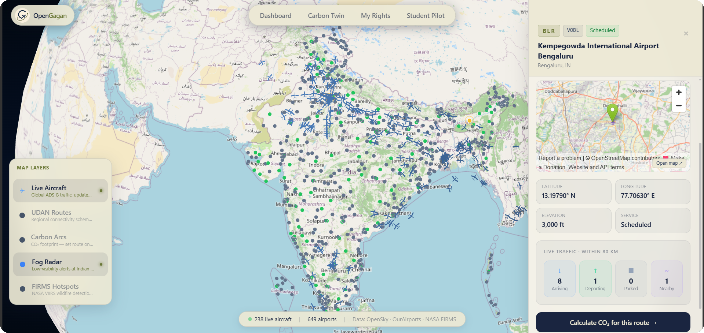
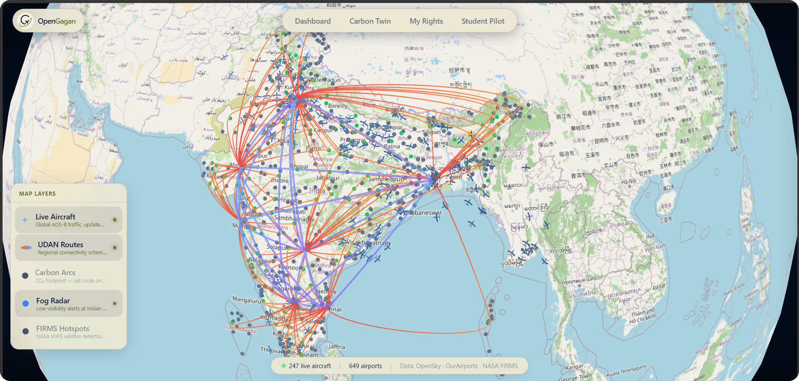

<div align="center">
  
  <br/><br/>
  <p><strong>A live 3D aviation map of India — free, open source, built in public.</strong></p>
  <p>
    <a href="#pages">Pages</a> ·
    <a href="#setup">Setup</a> ·
    <a href="#static-config">Static Config</a> ·
    <a href="#data-sources">Data Sources</a> ·
    <a href="#contributing">Contributing</a>
  </p>
  <br/>
  
  
  
  
  <br/><br/>
  
  <p><sub>Live aircraft (247–3000+ depending on source) · 649 airports · UDAN routes · ADS-B via OpenSky or airplanes.live</sub></p>
</div>

---

## What is this?

OpenGagan started as a question: *which parts of India are actually connected by air, and which aren't?*

It pulls live ADS-B aircraft data, plots every Indian airport on a 3D globe, and colours them by whether they have real scheduled service or are just sitting idle. On top of that it layers carbon emissions, wildfire hotspots, fog alerts, and passenger rights — all from free public data.

Nothing is paywalled. No accounts needed to run it. Fork it, run it locally, extend it however you like.

---

## Screenshots

<table>
  <tr>
    <td align="center" width="50%">
      
      <br/>
      <strong>Live Dashboard</strong>
      <br/>
      <sub>Real-time aircraft positions over India, airports colour-coded by service status, and layer controls for fog, FIRMS, and carbon.</sub>
    </td>
    <td align="center" width="50%">
      
      <br/>
      <strong>UDAN Route Network</strong>
      <br/>
      <sub>Hub-and-spoke arcs showing which regional airports are connected under India's RCS UDAN scheme — and which aren't.</sub>
    </td>
  </tr>
</table>

---

## Pages

### Dashboard — the globe

The main screen. A full-browser 3D globe of India showing live aircraft moving in near-real time (positions refresh every 30 seconds from OpenSky Network). Airports are colour-coded:

- **Green** — has scheduled service and recent flights
- **Orange** — served under the UDAN regional connectivity scheme
- **Red** — idle or unserved (no flights in the last 30 days)

Click any airport to open its panel. Click any aircraft to see its callsign, airline, altitude, and speed. The layer panel (bottom-right) lets you toggle overlays:

| Layer | What it shows |
|---|---|
| Live Aircraft | Global ADS-B traffic over India |
| UDAN Routes | Regional flight arcs under the government scheme |
| Carbon Arcs | CO₂ footprint for the route you calculate in Carbon Twin |
| Fog Radar | Low-visibility alerts at Indian airports |
| FIRMS Hotspots | NASA VIIRS wildfire detections from the last 24 hours |

---

### Carbon Twin

Pick an origin airport, a destination, and a passenger count. It calculates the CO₂ footprint using the ICCT methodology — 90g CO₂ per revenue passenger kilometre, with an 8% indirect routing uplift. The result shows total emissions, per-passenger figure, how many tree-years it takes to absorb it, and the driving equivalent in kilometres.

The route also draws as an arc on the globe so you can see it visually.

> The CO₂ factor and routing uplift are in `shared/src/constants/dgca.ts` if you want to update them.

---

### My Rights

A decision tree based on DGCA CAR Section 3 Series M Part IV — the Indian passenger rights rules. Enter your situation (flight delayed, cancelled, or denied boarding), and it walks through what you're entitled to, with exact compensation amounts and the regulation reference for each one.

At the end you can export a pre-filled grievance letter as a PDF, ready to submit to AirSewa.

> **This page is fully client-side.** The DGCA compensation thresholds are static values in `shared/src/constants/dgca.ts` — no backend needed for the decision logic. These are the fallback values and they work offline.

---

### Student Pilot

Three tabs for learning Indian aviation:

1. **Airspace** — India's airspace classes (A, C, G) with altitude ranges and the rules that apply in each
2. **Procedure Builder** — drag-and-drop tool to build approach procedures (IAF → IF → FAF → MAP → Missed Approach)
3. **Quiz** — 7 questions on Indian airspace, ICAO airport codes, and aviation terminology

Everything here is client-side only. No API calls.

---

### Airport Detail

A dedicated page for each airport, reached by clicking "View full details" in the airport side panel. Shows ICAO/IATA codes, elevation, airport type, UDAN status, coordinates, and a photo pulled from Wikimedia Commons.

---

## Tech Stack

| Layer | What's used |
|---|---|
| Frontend | React 19, TypeScript, Vite, Tailwind CSS |
| Globe & Maps | Deck.gl (ArcLayer, ScatterplotLayer, TripsLayer) |
| Rights Tree | ReactFlow |
| State | Zustand, TanStack Query |
| PDF Export | jsPDF |
| Backend | Node.js, Express 5, MongoDB, Mongoose |
| Real-time | Server-Sent Events (SSE) for live aircraft |
| Monorepo | npm workspaces — `app/`, `server/`, `shared/` |

---

## Setup

You need Node 18+ and MongoDB running locally (or an Atlas connection string).

```bash
# 1. Clone and install
git clone https://github.com/your-username/opengagan.git
cd opengagan
npm install

# 2. Set up environment variables
cp server/.env.example server/.env
# Edit server/.env — add your MongoDB URI, OpenSky credentials, OpenWeatherMap key

# 3. Seed the airport database (run once)
npm run seed

# 4. Start everything
npm run dev
# Frontend → http://localhost:5173
# Backend  → http://localhost:4000
```

**Free API keys you need:**

| Service | Sign up at | Used for |
|---|---|---|
| OpenSky Network | opensky-network.org | Live aircraft positions |
| NASA FIRMS | firms.modaps.eosdis.nasa.gov | Wildfire hotspots |
| OpenWeatherMap | openweathermap.org | Fog and visibility |

---

## Static Config

Some data on the site is hardcoded rather than pulled from an API. These are the static fallback values — they work without any external service and are designed to be easy to edit.

All of them are plain JSON files in `shared/src/data/`:

| File | What's in it | Page that uses it |
|---|---|---|
| `airspace.json` | India's airspace classes (A, C, G) with rules and altitude ranges | Student Pilot → Airspace tab |
| `quiz.json` | 7 quiz questions with answer options | Student Pilot → Quiz tab |
| `airlines.json` | ICAO prefix → airline name (19 airlines) | Live aircraft panel |
| `layers.json` | Globe layer names, descriptions, and indicator styles | Layer controls |
| `procedures.json` | Approach waypoint types with colours and labels | Procedure Builder |
| `reg-prefixes.json` | ICAO registration prefix → country name | Live aircraft origin country |

DGCA compensation thresholds are in `shared/src/constants/dgca.ts` (TypeScript constants, equally easy to edit).

**Want to add a quiz question?** Open `shared/src/data/quiz.json` and add an object with `q`, `a`, and `options`. No code changes needed.

**Want to add an airline?** Open `shared/src/data/airlines.json` and add `"ICAO_PREFIX": "Airline Name"`.

**Want to add a country?** Open `shared/src/data/reg-prefixes.json` and add `"PREFIX": "Country Name"`. Prefixes are from ICAO Annex 7 (e.g. `"VT"` = India, `"G"` = UK).

**Want to update compensation rules?** Edit the numbers in `shared/src/constants/dgca.ts`.

---

## Data Sources & Credits

Every data source used in this project is free and publicly attributed. Here's exactly what we pull, from where, and why.

### Live Aircraft

| Source | URL | What it gives us |
|---|---|---|
| **OpenSky Network** (primary) | `opensky-network.org/api` | Live ADS-B aircraft states over India — callsign, position, altitude, heading. OAuth2. Non-commercial research use. |
| **airplanes.live** (fallback) | `api.airplanes.live/v2/point` | Used automatically if OpenSky is down or over daily credit limit. Same ADS-B data, no auth needed. |

### Airport Database

| Source | URL | What it gives us |
|---|---|---|
| **OurAirports** | `davidmegginson.github.io/ourairports-data/airports.csv` | 467 Indian airports — ICAO/IATA codes, coordinates, elevation, type, scheduled service flag. Public domain. |

### Airport Photos

| Source | What it gives us |
|---|---|
| **Wikidata SPARQL** | First lookup — finds the Commons category for an airport by ICAO code |
| **Wikimedia Commons API** | Pulls airport photos from the category found via Wikidata |
| **Wikipedia API** | Fallback — searches the Wikipedia article for the airport and grabs images from it |

Photo lookup tries Wikidata first, then Commons search, then Wikipedia — stops as soon as it finds something.

### UDAN & Traffic Data

| Source | URL | What it gives us |
|---|---|---|
| **Vonter / india-aviation-traffic** | `raw.githubusercontent.com/Vonter/india-aviation-traffic` | Passenger traffic CSVs by airport and year — used to identify UDAN-served airports with no recent flights. ODbL licence. |

### Weather & Fog

| Source | URL | What it gives us |
|---|---|---|
| **AMSS Delhi** (primary fog) | `amssdelhi.gov.in/fog/nitc15.php` | IGI Airport RVR (runway visual range) data — scrapped directly from the government met page. |
| **OpenWeatherMap** (fallback) | `api.openweathermap.org/data/2.5/weather` | Fog and visibility for other airports when AMSS data isn't available. Free tier API key needed. |

### Wildfire Hotspots

| Source | URL | What it gives us |
|---|---|---|
| **NASA FIRMS** | `firms.modaps.eosdis.nasa.gov/api/country/csv/…/VIIRS_SNPP_NRT/IND/1` | VIIRS satellite fire detections in India from the last 24 hours. Free NASA FIRMS MAP key needed. |

### Passenger Rights

| Source | What it gives us |
|---|---|
| **DGCA CAR Section 3 Series M Part IV** | Compensation thresholds, entitlement rules, and regulatory references. Public government document. Static — no API. |

### Dataset Freshness

| Source | URL | What it gives us |
|---|---|---|
| **GitHub API** | `api.github.com` | Latest commit SHA and date for OurAirports and Vonter datasets — shown in the status bar so you know how fresh the seeded data is. |

---

## Project Structure

```
opengagan/
├── app/          React frontend (Vite + TypeScript)
├── server/       Node.js backend (Express 5 + MongoDB)
├── shared/       Types and constants used by both
│   └── src/
│       ├── constants/   dgca.ts · india.ts · opensky.ts
│       └── data/        airspace.json · quiz.json · airlines.json · layers.json · procedures.json
├── seed/         One-time data loaders (airports + UDAN)
└── docs/         Architecture notes
```

---

## Contributing

The easiest contributions are edits to the JSON files in `shared/src/data/` — no TypeScript needed, just open the file and change values.

All data sources must stay free and open. If you're adding a new feature that pulls from an external API, it needs a free tier or be fully public.

Open an issue before large changes so we can talk through the approach.

---

## Data Notice

**OpenGagan is a data visualisation tool, not an authoritative aviation source.**

- Aircraft positions are sourced from ADS-B and may be delayed, incomplete, or inaccurate
- Airport data comes from OurAirports (community-maintained) and may not reflect current status
- UDAN route data is from historical passenger traffic CSVs — it does not represent live schedules
- Carbon calculations are estimates based on ICCT methodology and are not certified figures
- DGCA compensation values are from the public CAR document — always verify with the official DGCA circular before filing a claim
- Fog and weather data may lag real conditions by up to 60 minutes

**Do not use this app for flight planning, navigation, or legal decisions.**

---

## License

MIT — see [LICENSE](LICENSE). Pull requests and contributions welcome.

*Data credits: [OpenSky Network](https://opensky-network.org) (non-commercial research) · [airplanes.live](https://airplanes.live) · [OurAirports](https://ourairports.com) (public domain) · [Vonter/india-aviation-traffic](https://github.com/Vonter/india-aviation-traffic) (ODbL) · [NASA FIRMS](https://firms.modaps.eosdis.nasa.gov) · [OpenWeatherMap](https://openweathermap.org) · [Wikimedia Commons](https://commons.wikimedia.org) · [AMSS Delhi](https://amssdelhi.gov.in) · DGCA (public govt document)*
